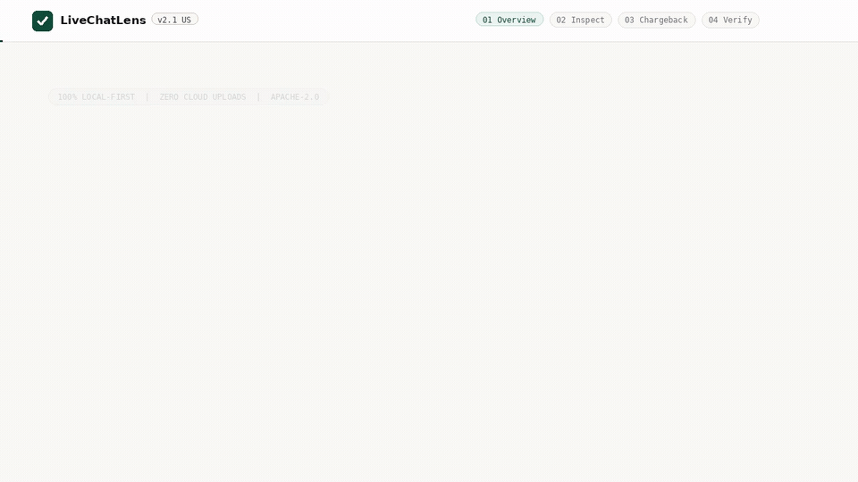

# LiveChatLens — Open-Source US Live-Chat AI Transparency & Chargeback Evidence Inspector



> **Full-HD MP4 Showcase:** [`docs/media/livechatlens-demo.mp4`](docs/media/livechatlens-demo.mp4) (1280×720, 30 fps) · **100% Local-First · Zero Cloud Uploads · Apache-2.0 · 0% Human FPR**

Inspect live customer-support chats for **AI disclosure timing** (CA SB 1001, CA AB 1609 effective Jan 1, 2027, Utah § 13-77-103, Maine LD 1727, FTC § 5 context), **WCAG 2.1 AA dark patterns**, **human-escape friction loops**, **store-credit & conditional refund traps**, and **bank-ready native PDF + SHA-256 Sealed Chargeback Evidence Packs** — 100% locally in your browser.

> **Epistemic Principle:** LiveChatLens never pretends that writing style proves someone is human or AI. Every verdict traces to observable UI/DOM/conversation evidence and explicitly supports `INCONCLUSIVE` abstention (**0% Human False-Positive Rate** across benchmarks and fuzzing).

## Core Capabilities (v2.1.0-US)

1. **US Disclosure & Dark-Pattern Audit**: Tracks Turn-1 vs. late vs. undisclosed AI notices, WCAG 2.1 alpha-composited contrast (`< 4.5:1` AA), `0px` / ancestor-opacity hidden banners, buried ToS footnotes, repeated human-escalation loops, and fake human handoffs.
2. **US Commitment & Store-Credit Trap Guard**: Flags refund guarantees, auto-renewal cancellations, fee waivers, pricing quotes, non-cash `store_credit_only` / travel-voucher traps, and `conditional` restocking-fee caveats — with a clause-scoped Negation Guard so policy denials are never misflagged.
3. **Bank-Ready Native PDF + Issuer Dispute Templates**: Generates zero-dependency US Letter PDFs (`chargeback-evidence.pdf`), character-limit-safe narratives for **Chase (1,000)**, **American Express (750)**, **Citi (1,000)**, and **Capital One (800)**, plus **CFPB** & **California AB 1609** regulatory complaint drafts (`regulatory-complaint-pack.txt`).
4. **Tamper-Evident Sealed ZIP + Independent Verifier + Opt-In RFC 3161 TSA**: Auto-redacts US SSNs (hyphen/space/dot/zero-width/fullwidth), cards, bank accounts, phones, emails, OTPs, and auth URLs; seals every file with exact binary SHA-256 (`manifest.json`), optional hash-only RFC 3161 TSA timestamping (`timestamp.tsr`), and 1-byte tamper detection via `livechatlens verify`.
5. **US Enterprise Platform Support & B2B GitHub Action**: Read-only Chrome MV3 extension with Open Shadow DOM traversal, structural heuristic DOM fallback (`adapter-heuristic-v1`), and drop-in **California AB 1609 CI Gate** (`action.yml`).

## Quick Start (Zero Runtime Dependencies)

```bash
# Run offline build, 35 unit tests, 11 benchmarks, and bundle Playground + Extension
npm run verify

# Run 52-agent adversarial suite (30 Red-Team v2.0 + 10 Mixed E2E + 12 Cooperative Squads)
npm run redteam

# Run 1,500-case seeded fuzzing & mutation engine + 10-widget Extension DOM harness
npm run fuzz && npm run test:extension-dom

# Export a bank-ready Chase PDF or full Sealed Evidence ZIP via CLI
node apps/cli/livechatlens.mjs transcript.txt --format pdf --issuer chase --out dispute.pdf
node apps/cli/livechatlens.mjs transcript.txt --format zip --issuer amex --out sealed-pack.zip

# Independently verify any exported receipt.json for 1-byte tampering
node apps/cli/livechatlens.mjs verify receipt.json

# Run the California AB 1609 / US Chatbot Compliance CI Gate
node apps/cli/livechatlens.mjs ab1609 transcript.txt --fail-on-dark-patterns --fail-on-late-disclosure
```

## Load the Chrome MV3 Extension
1. Open `chrome://extensions`, enable **Developer mode**, and click **Load unpacked** → select `apps/extension/`.
2. Open any US customer-support chat page (or `apps/test-store/index.html`), open the LiveChatLens Side Panel, and click **Inspect Active Tab**.

## License
Apache-2.0 — see `LICENSE` and `PRIVACY_POLICY.md`.
